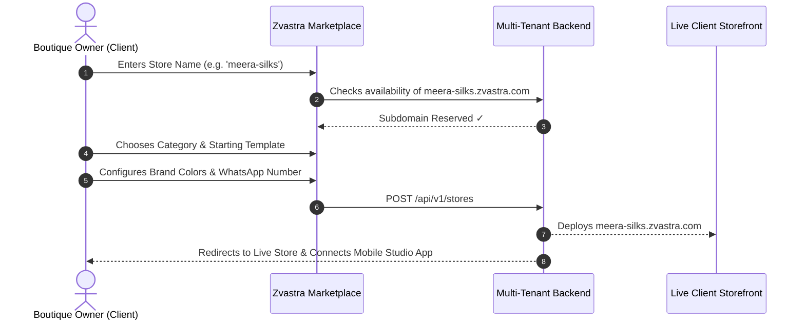

# Zvastra — South Asian Haute Couture Marketplace & Multi-Tenant Website Builder

A WordPress/Shopify-style multi-tenant website builder and commerce engine tailored for independent ethnic apparel, bridal couture, handloom silks, and designer jewelry boutiques. Built with **React Native (Expo)**, **Node.js (TypeScript)**, and a **dynamic web storefront engine**.

---

## 🌟 Platform Highlights

### 1. Main Marketplace Portal (`zvastra.com`)
- **South Asian Couture Directory**: Shoppers can browse verified boutique studios across lehengas, banarasi silks, fusion wear, and handcrafted polki jewelry.
- **60-Second Client Onboarding**: Independent boutique owners can reserve their custom handle (`[brand].zvastra.com`), choose starting layouts, and launch their website in under a minute.

### 2. Modular Component-Based Site Builder
Clients build and customize their websites using reusable e-commerce blocks:
- **`HeroBannerBlock`**: Editorial header with brand logo, tagline, banner photo/video, and action buttons.
- **`VideoReelsBlock`**: Vertical 9:16 Instagram-style demo reels showing fabric flow, saree sheen, and embroidery detail.
- **`ProductGridBlock`**: Filterable catalog with photo zoom, size variant pills (S, M, L, Custom), and pricing.
- **`WhatsAppPillBlock`**: Sticky 1-click ordering button connecting shoppers directly to the artisan's WhatsApp Business chat.
- **`StoryCraftBlock`**: Storytelling block highlighting loom origin, master weavers, and Silk Mark certifications.
- **`CustomLinksBlock`**: Linktree-style external buttons (e.g. *Book a Video Consultation*, *Download Lookbook PDF*).

### 3. Zvastra Seller Studio Mobile App (`apps/mobile`)
A dedicated cross-platform app (iOS & Android) for boutique owners:
- **Multi-Store Switcher**: Manage multiple boutique brands from a single login.
- **Theme & Branding Customizer**: Switch templates on the fly, adjust brand colors, and edit taglines.
- **Product & Media Studio**: Take photos, upload vertical video reels, and manage inventory right from your smartphone.
- **Live In-App Store Preview**: Test how your store looks on mobile with live WhatsApp checkout simulation.
- **Customer Lead Management**: Receive buyer inquiries with a 1-tap *"Reply on WhatsApp"* button.

---

## 📁 Repository Structure

```text
zvastra/
├── backend/            # Multi-Tenant REST API & Site Engine (Node.js + Express + TypeScript)
│   ├── src/
│   │   ├── routes/     # /auth, /stores, /templates, /products, /inquiries
│   │   ├── services/   # StoreService, ProductService
│   │   ├── data/       # Seed data for bridal couture, silk sarees, and video reels
│   │   ├── types/      # Shared TypeScript data models
│   │   └── server.ts   # Express server with Marketplace Landing Page + Live Preview at /preview/:slug
│   └── package.json
│
├── mobile/             # Zvastra Seller Studio App (React Native + Expo SDK 51)
│   ├── App.tsx         # Bottom tab navigation with live lead badge counters
│   ├── app.json        # Expo app configuration
│   ├── babel.config.js # Babel setup with Expo presets
│   ├── metro.config.js # Metro bundler configuration with macOS fsevents support
│   └── src/
│       ├── screens/    # Dashboard, Templates, Products, ProductForm, StorePreview, Inquiries
│       ├── state/      # React Context (multi-store switcher, theme customizer)
│       ├── services/   # REST API client with offline fallback
│       └── types/      # Data types matching backend contracts
│
└── web-storefront/     # Dynamic Web Storefront Engine (HTML/CSS/JS)
    ├── index.html      # Renders custom templates, video reels & direct WhatsApp checkout
    └── package.json
```

---

## 🚀 Quick Start Guide

### Prerequisites
- **Node.js**: v20+ or v22 LTS (installed on your system).

---

### 1. Start the Backend API & Marketplace Portal
```bash
cd backend
npm run build
npm start
```
- **Marketplace Landing Page & Client Onboarding**: [http://localhost:4000](http://localhost:4000)
- **Live Client Website Previews**:
  - *Ananya Heritage Couture* (Classic Boutique Theme): [http://localhost:4000/preview/ananya-couture](http://localhost:4000/preview/ananya-couture)
  - *Ananya Studio Reels* (Video First Theme): [http://localhost:4000/preview/ananya-reels](http://localhost:4000/preview/ananya-reels)
- **REST API Base**: `http://localhost:4000/api/v1`

---

### 2. Run the Mobile Seller Studio App (React Native / Expo)
```bash
cd mobile
npx expo start
```
- **Web Browser**: Press `w` in your terminal to open the app directly in your desktop browser.
- **Physical Phone**: Scan the QR code using the **Expo Go** app on your iPhone or Android.
- **Simulators**: Press `i` for iOS Simulator or `a` for Android Emulator.

---

### 3. Run the Standalone Web Storefront Engine
```bash
cd web-storefront
npx serve -l 3000 .
```
Open [http://localhost:3000](http://localhost:3000) to test dynamic client site rendering and theme switching.

---

## 🎨 Available Templates

| Template | Aesthetic | Best Suited For |
| :--- | :--- | :--- |
| **Classic Boutique Glamour** (`classic-boutique`) | Editorial hero banners, royal burgundy & gold accents, high-conversion product grid. | Bridal lehengas, pure silk sarees, couture gowns. |
| **Video Reels Showroom** (`video-reels`) | Dark mode vertical video cards showing fabric flow, swish demo reels, and live styling. | Indo-Western fusion, festive ready-to-wear, statement jewelry. |
| **Minimalist Clean Catalog** (`minimal-catalog`) | Clean, high-speed product catalog optimized for fast mobile browsing and direct WhatsApp ordering. | Daily ethnic wear, block-printed kurtis, dupattas, artisanal home decor. |

---

## 🤝 Client Onboarding Flow



---

## 📄 License
MIT © Zvastra
